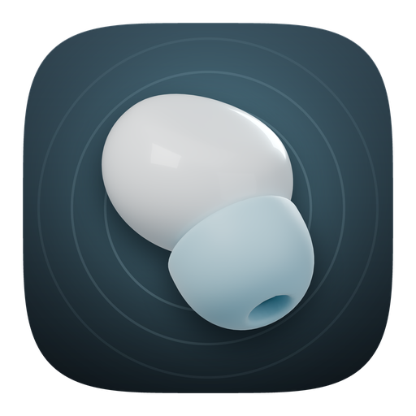
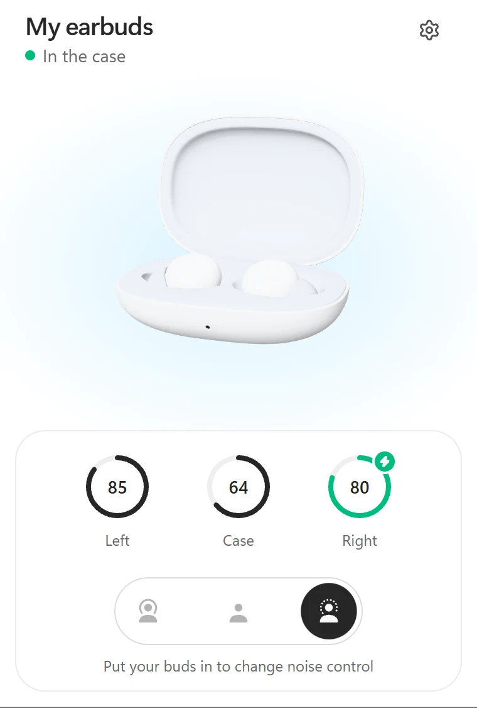
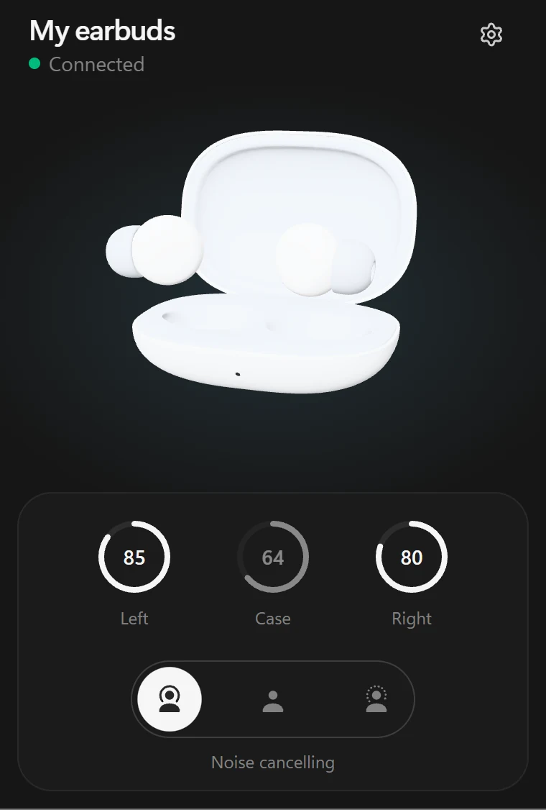

  

<h1 align="center">FitsWise</h1>

  A small, free Windows app for <b>Beats Fit Pro</b>: battery for each bud and the case, noise control,
  press-and-hold, and a popup when your buds connect.

  <a href="https://github.com/Nweremizu/fitswise/releases/latest"><b>Download for Windows</b></a> ·
  <a href="https://nweremizu.github.io/fitswise/">Website</a> ·
  <a href="CONTRIBUTING.md">Contribute</a>

  
  

## Features

- **Battery** for the left bud, right bud and case, live, with the last known level kept while a bud is busy.
- **Noise control**: noise cancelling, transparency or off, from the app, the tray or a shortcut.
- **Settings from the phone app**: press-and-hold for each bud, automatic ear detection, noise control with one
  bud, and renaming.
- **A 3D view that follows your buds**: in the case, out of it, or worn with the case shut.
- **A popup when your buds connect**, hidden while a game or film is fullscreen.
- **Global shortcuts** (Ctrl+Alt+Shift+1, 2, 3, B by default), each one changeable, with clashes reported.
- **Lives in the tray**, can start with Windows, and **updates itself** with signed releases.
- **Small**: an installer under 3 MB and about 6 MB of memory while waiting in the tray.

## Install

1. Download the latest `FitsWise_x.y.z_x64-setup.exe` from [Releases](https://github.com/Nweremizu/fitswise/releases/latest).
2. Pair your Beats Fit Pro in **Windows Settings → Bluetooth & devices** if you haven't already.
3. Run the installer. Windows SmartScreen may warn that the publisher is unknown, because releases aren't signed
   with a paid certificate yet. Choose **More info → Run anyway**.

FitsWise installs for your user only and needs no administrator rights. Windows 10 and 11, x64.

## How it works

FitsWise talks to the buds over the Bluetooth serial channel that the official Android app uses (Apple's "B2P"
protocol), and only while Windows already has the buds connected for audio, so it never pulls them away from your
phone. No driver is needed. What we learned about the protocol is in [docs/spec.md](docs/spec.md).

Only Beats Fit Pro are supported for now. Other Beats get a "not supported yet" message, and FitsWise sends them
nothing. Help with other models is very welcome.

## Privacy

No account and no analytics. The only network request is the update check against this repository's releases,
which you can turn off in Settings.

## Contributing

Bug reports, protocol findings, translations and code are all welcome. Start with [CONTRIBUTING.md](CONTRIBUTING.md).

## Licence

[MIT](LICENSE). Beats and Beats Fit Pro are trademarks of Apple Inc. FitsWise is an independent project and isn't
affiliated with, endorsed by or sponsored by Apple or Beats.
